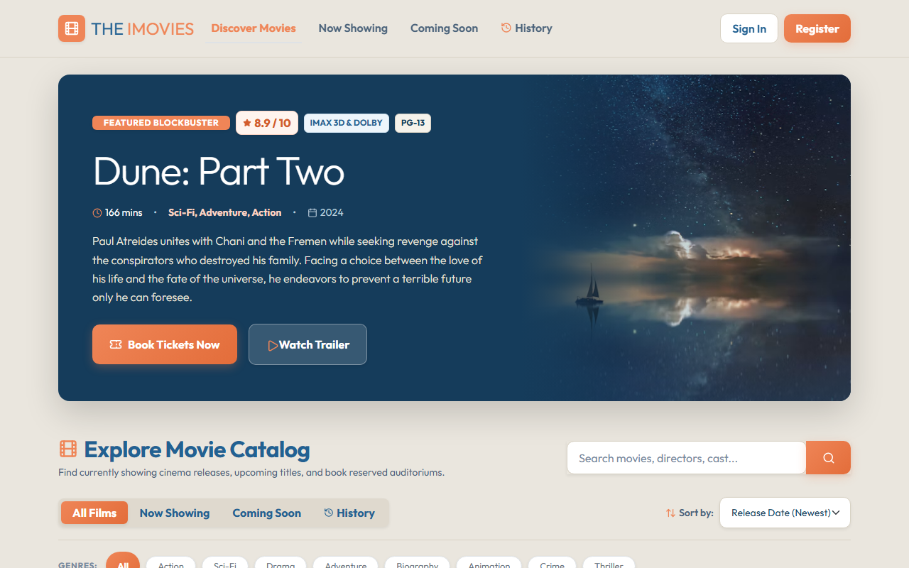
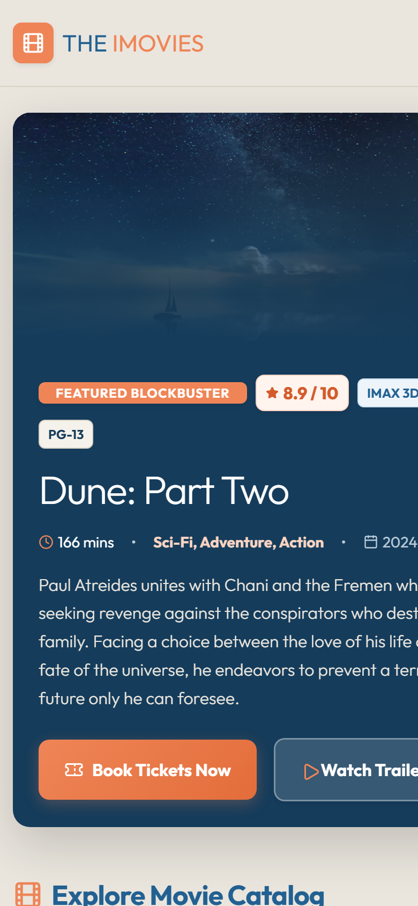

# 🎬 The IMovies

> **Modern Cinema Discovery & Reserved Auditorium Seat Booking Platform**  
> A full-stack web application connecting movie enthusiasts with multiplex cinemas featuring real-time seat locks, Indian Rupee (INR ₹) pricing, high-contrast cinema aesthetics, and verified digital ticket issuance.

---

## 📸 Visual Previews

### Desktop Showcase (Featured Hero Section & Catalog)


### Mobile & Tablet Experience
<p align="center">
  
</p>

---

## 🌟 Key Highlights

- **🍿 Blockbuster Discovery & Media**:
  - Dynamic **Hero Banner** highlighting featured blockbusters with custom cinematic gradient blending.
  - Live filtering for **Now Showing** vs. **Coming Soon** releases.
  - Genre filters (Action, Sci-Fi, Drama, Adventure, Biography, Animation, Crime, Thriller).
  - Instant client & server-side search across title, director, and cast.
  - Embedded YouTube trailer streaming inside a backdrop modal.

- **🪑 Interactive Auditorium Seat Map**:
  - Responsive **88-seat grid** modeled across **VIP**, **Premium**, and **Standard** tiers.
  - Real-time seat status indicators (`Available`, `Selected`, `Held`, `Booked`).
  - **10-minute temporary seat hold** with live countdown timer to prevent race conditions and double-booking.
  - Auto-release mechanism when hold expires or when a user deselects.

- **🎟️ Streamlined Ticket Booking & Educational Payment Sandbox**:
  - Interactive **Educational Demo Payment Gateway**: simulated Card (Visa, Mastercard, RuPay with live preview and test autofill), UPI & dynamic QR code, Net Banking, and Wallets.
  - Realistic **3D-Secure 2.0 / OTP verification simulation** with instant settlement and verified digital ticket pass issuance.
  - Dedicated **Ticket Booking History & Archive (`/history`)** accessible directly beside *Coming Soon* in the navigation bar and homepage status tabs.
  - Print-friendly ticket layout formatted for clean physical receipts.
  - Self-service cancellation for eligible upcoming showtimes (> 2 hours prior to start) with automatic seat inventory restoration.

- **📊 Cinema Administration Portal (`/admin`)**:
  - KPI overview metrics (total revenue in ₹, tickets booked, active movies, and scheduled screenings).
  - Movie catalog management (create, update, feature, or archive films).
  - Showtime scheduling with automatic auditorium seat grid generation and tier pricing in INR (`₹`).

- **🇮🇳 Indian Rupee (INR) Standardization**:
  - Consistent Indian numbering formatting (`₹250`, `₹1,250`) using `en-IN` locale across the entire system.
  - Realistic ticket pricing defaults (Standard: ₹220, Premium: ₹350, VIP: ₹550).

---

## 🎨 Cinema Design System

Built on a bespoke editorial cinema palette with high contrast and smooth micro-interactions:

| Token | Hex Code | Purpose |
| :--- | :--- | :--- |
| **Warm Ivory** | `#EAE6DE` | Primary application background & soft card surfaces |
| **Deep Editorial Blue** | `#226192` / `#153C5B` | Typography, headings, navigation bar, and hero cards |
| **Coral Orange** | `#EF8557` | Primary calls to action, highlights, selected seats, badges |
| **Surface White** | `#FFFFFF` | Movie cards, modals, and content containers |
| **Slate Navy** | `#4B637A` | Metadata icons, secondary labels, and subtitles |

---

## 🛠️ Technology Stack

### Frontend
- **Framework**: [React 19](https://react.dev/) + [Vite](https://vitejs.dev/)
- **Routing**: [React Router v7](https://reactrouter.com/)
- **Styling**: [Bootstrap 5.3](https://getbootstrap.com/) + Custom Cinema Design System Tokens (`index.css`)
- **Icons**: [Lucide React](https://lucide.dev/)
- **HTTP Client**: [Axios](https://axios-http.com/) with centralized interceptors & demo fallback

### Backend
- **Runtime**: [Node.js](https://nodejs.org/) (v18+)
- **Framework**: [Express 4](https://expressjs.com/)
- **Database**: [MongoDB](https://www.mongodb.com/) (Local or Atlas Cloud) with [Mongoose ODM](https://mongoosejs.com/)
- **Authentication**: JWT (`jsonwebtoken`) with HTTP-ready payload validation & role-based route guards
- **Security**: `bcryptjs` for salted password hashing, `express-validator` for request sanitization, and strict CORS configuration

---

## 📁 Repository Structure

```text
IMOVIE/
├── backend/
│   ├── config/            # Database connection setup (db.js)
│   ├── controllers/       # Auth, Movie, Showtime, Booking, and Admin controllers
│   ├── middleware/        # JWT auth verification, admin role guard, input validators
│   ├── models/            # Mongoose schemas (User, Movie, Theatre, Showtime, Booking)
│   ├── routes/            # REST API route endpoints
│   ├── scripts/           # Safe seed script (seed.js) & admin promoter (promoteAdmin.js)
│   ├── .env.example       # Backend environment configuration template
│   └── server.js          # Express entrypoint
├── frontend/
│   ├── src/
│   │   ├── api/           # Axios instance with auth headers & timeout handling
│   │   ├── components/    # Reusable UI (HeroBanner, MovieCard, SeatMap, Navbar, Footer)
│   │   ├── context/       # AuthContext for session management
│   │   ├── data/          # Offline demo cinema showcase data (demoData.js)
│   │   ├── pages/         # HomePage, MovieDetailsPage, SeatSelectionPage, CheckoutPage, AdminDashboard
│   │   ├── utils/         # Currency formatter (currency.js)
│   │   ├── App.jsx        # Routing configuration
│   │   ├── index.css      # Custom cinema design tokens & styles
│   │   └── main.jsx       # React DOM root entry
│   ├── .env.example       # Frontend environment configuration template
│   └── vite.config.js     # Vite configuration with /api proxy
├── docs/
│   └── PROJECT_DOCUMENTATION.md # Comprehensive 500+ line technical specification
├── hero_desktop.png       # Desktop visual preview artifact
├── hero_mobile.png        # Mobile visual preview artifact
├── .env.example           # Root environment configuration template
├── .gitignore             # Git ignore rules protecting secrets & build files
└── package.json           # Root workspace scripts (concurrent execution)
```

---

## 🚀 Quickstart & Setup Guide

### 1. Prerequisites
- **Node.js**: `v18.0.0` or higher ([Download](https://nodejs.org/))
- **MongoDB**: Local MongoDB instance (`mongodb://localhost:27017/imovie`) or a free [MongoDB Atlas](https://www.mongodb.com/cloud/atlas) cluster connection string.
- **Git**

---

### 2. Clone the Repository
```bash
git clone https://github.com/somilmalviy8-spec/IMOVIE.git
cd IMOVIE
```

---

### 3. Install Dependencies
Install dependencies for both root, backend, and frontend:

```bash
# Install root orchestration tools
npm install

# Install backend dependencies
cd backend && npm install

# Install frontend dependencies
cd ../frontend && npm install

# Return to root directory
cd ..
```

---

### 4. Configure Environment Variables

Create `.env` inside the `backend/` directory:

```bash
# Copy example template
cp backend/.env.example backend/.env
```

Open `backend/.env` and configure your credentials:

```ini
PORT=5000
NODE_ENV=development

# MongoDB Connection String (Replace with your Atlas or local URI)
MONGODB_URI=mongodb://localhost:27017/imovie

# JWT Secret (Use a strong random key, minimum 32 characters)
JWT_SECRET=your_super_secret_jwt_key_min_32_characters_long
JWT_EXPIRES_IN=7d

# Frontend Origin for CORS
CLIENT_URL=http://localhost:5173
```

*(Optional)* Create `frontend/.env` if your backend runs on a custom domain:
```ini
VITE_API_URL=/api
```

> **Note**: Real `.env` files are strictly excluded from version control via `.gitignore`. Never commit production passwords or connection strings.

---

### 5. Seed Demo Cinema Data (Optional but Recommended)
Populate your database with realistic demo data (movies, theatres, screens, and showtimes with INR pricing):

```bash
# From the root directory:
npm run seed
```

*What the seed script adds:*
- **7 Movies** (Dune: Part Two, Oppenheimer, Interstellar, Spider-Man, The Dark Knight, Inception, Gladiator II)
- **3 Multiplex Theatres** with multiple screens (PVR Director's Cut, INOX Megaplex, Cinepolis VIP)
- **18 Showtimes** across dates with 88-seat layouts (VIP: ₹550, Premium: ₹350, Standard: ₹220)
- *Note:* The seed script is 100% idempotent and does not create hardcoded users or passwords.

---

### 6. Promote an Administrator User (Optional)
After registering an account through the UI, elevate the user to `admin` using the secure CLI utility:

```bash
# From the root directory:
npm run make-admin your_email@example.com
```

---

### 7. Run the Application

You can launch both the backend API and frontend dev server simultaneously with one command from the project root:

```bash
npm run dev
```

Or run them individually in separate terminals:

```bash
# Terminal 1 - Backend Server (Port 5000)
npm run server

# Terminal 2 - Frontend Client (Port 5173)
npm run client
```

Open your browser at **[http://localhost:5173](http://localhost:5173)** to explore **The IMovies**!

---

## 📡 REST API Reference

| Method | Endpoint | Access | Description |
| :--- | :--- | :--- | :--- |
| **POST** | `/api/auth/register` | Public | Register a new customer account |
| **POST** | `/api/auth/login` | Public | Authenticate user & return JWT token |
| **GET** | `/api/auth/me` | Authenticated | Retrieve current user profile |
| **PUT** | `/api/auth/profile` | Authenticated | Update user name, phone, or preferences |
| **PUT** | `/api/auth/change-password` | Authenticated | Secure password change |
| **GET** | `/api/movies` | Public | List movies with status, genre & search query filters |
| **GET** | `/api/movies/:id` | Public | Retrieve movie details & synopsis by ID/slug |
| **GET** | `/api/theatres` | Public | List all active cinemas & screens |
| **GET** | `/api/showtimes` | Public | Fetch scheduled screenings grouped by movie & date |
| **GET** | `/api/showtimes/:id` | Public | Fetch showtime details and live 88-seat map status |
| **POST** | `/api/showtimes/:id/hold` | Authenticated | Acquire atomic 10-minute hold on selected seats |
| **POST** | `/api/showtimes/:id/release` | Authenticated | Release temporary seat holds |
| **POST** | `/api/bookings` | Authenticated | Confirm reservation & issue digital ticket pass |
| **GET** | `/api/bookings/my` | Authenticated | View current customer's booking history |
| **GET** | `/api/bookings/:id` | Authenticated | Fetch specific booking confirmation & digital ticket pass |
| **POST** | `/api/bookings/:id/cancel` | Authenticated | Cancel an eligible future booking |
| **GET** | `/api/admin/stats` | Admin | Retrieve aggregate revenue (₹) & ticket KPIs |
| **POST** | `/api/admin/movies` | Admin | Add new movie release to cinema catalog |
| **POST** | `/api/admin/showtimes` | Admin | Schedule a screening and generate auditorium seat grid |

---

## 🔒 Concurrency & Seat Reservation Logic

To prevent double-booking under high demand, **The IMovies** uses an atomic two-phase seat locking protocol:

```text
[Available] ──(User selects seat)──> [Hold acquired: 10-Min TTL]
                                              │
             ┌────────────────────────────────┴────────────────────────────────┐
             ▼                                                                 ▼
   [Confirmed Booking]                                               [Hold Expiration / Deselect]
(Single-click confirmation)                                       (Automatic revert to Available)
```

1. **Temporary Hold Acquisition**:
   - Executes an atomic MongoDB condition checking that all requested seat numbers currently have `status === 'available'` or an expired hold (`holdExpiresAt < new Date()`).
   - Writes the customer's user ID and sets `holdExpiresAt = new Date(Date.now() + 10 * 60 * 1000)`.
2. **Booking Finalization**:
   - Ensures that the seats being confirmed belong to the active holding user and that the hold timestamp is still valid.
   - Converts the seat state from `held` to permanently `booked`, assigns unique ticket serials, and persists the booking record.

---

## 📄 License & Credits

- **Author**: Somil Malviy ([somilmalviy8@gmail.com](mailto:somilmalviy8@gmail.com))
- **License**: [ISC](LICENSE)
- **Built for**: High-performance cinema discovery and ticket reservation.
