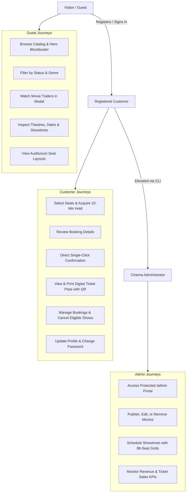
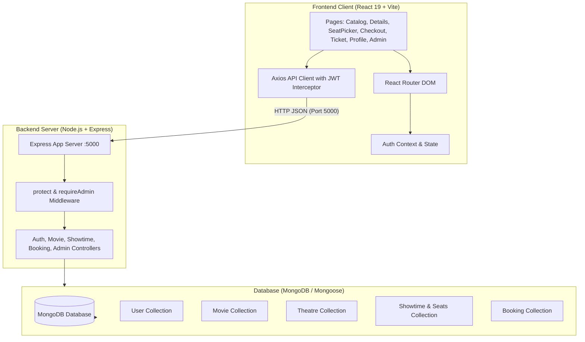
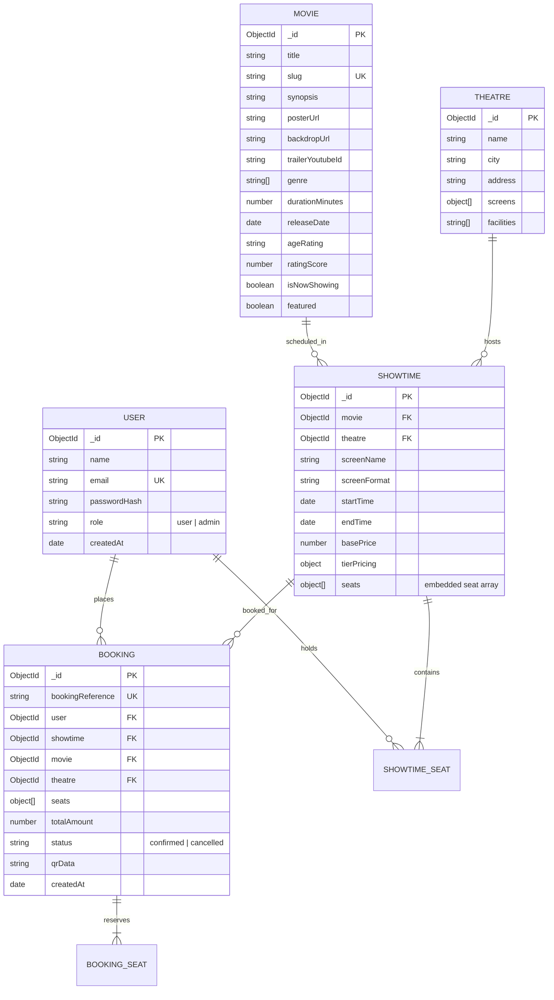

# 🎬 The IMovies - Complete Project Specification & Technical Documentation

---

## 1. Project Overview and Goals

### 1.1 Project Overview
**The IMovies** is a full-stack cinema discovery and ticket booking web application. It connects movie enthusiasts with local multiplex cinemas, allowing users to browse now-showing and upcoming films, watch trailers, select preferred dates and showtimes, pick specific seats from an interactive auditorium seat map, and confirm reservations with instant digital ticket issuance.

### 1.2 Core Project Goals
- **Immersive Cinema Experience**: Deliver a polished, cinema-inspired visual experience with Warm Ivory (`#EAE6DE`) background, Deep Editorial Blue (`#226192`) typography & headings, Coral Orange (`#EF8557`) calls to action, crisp white surfaces, high contrast, and smooth transitions.
- **Strict Cross-Device Responsiveness**: Guarantee full usability and aesthetic consistency across mobile (<576px), tablet (768px–991px), and desktop (≥992px) screens with zero horizontal scrolling.
- **Concurrency & Double-Booking Prevention**: Implement robust atomic seat locking and hold expiration logic in MongoDB to prevent simultaneous reservations of the same seat.
- **Academic Scope Discipline**: Focus on core full-stack software engineering principles (REST architecture, database modeling, authentication, state management) while explicitly excluding complex external payment gateways and third-party financial liabilities.

---

## 2. User Roles and Main User Journeys

The IMovies defines three distinct actor roles:



### 2.1 Visitor / Guest Journey
1. **Discover**: Land on the home page, explore the featured banner film, filter by "Now Showing" vs. "Coming Soon", and filter by genre (Action, Sci-Fi, Drama, etc.).
2. **Search**: Search movies by title, director, or cast keywords.
3. **Film Details**: Open the movie details view to read synopsis, inspect age rating, duration, and stream the official YouTube trailer inside a modal.
4. **Schedule Inspection**: Select dates from the horizontal date picker and view grouped showtimes by theatre with screening formats (IMAX 3D, Dolby Atmos, Standard 2D, VIP Lounge).
5. **Seat Preview**: Open the seat map to view live availability. Attempting to hold seats triggers the accessible sign-in/registration modal.

### 2.2 Registered Customer Journey
1. **Authentication**: Register with name, email, and password, or sign in via JWT.
2. **Seat Selection**: Select up to 8 available seats from the visual auditorium map. Tiers (Standard, Premium, VIP) update the live price tally.
3. **Seat Hold**: Proceeding to checkout places an atomic 10-minute hold on the selected seats. A countdown timer alerts the user to the remaining hold time.
4. **Review & Confirmation**: Review film details, showtime, auditorium, and itemized ticket pricing. Confirm booking with a single click without payment collection.
5. **Digital Ticket Pass**: Receive a verified digital ticket with a unique booking reference (e.g., `IM-84F2A1`), cinema details, and scannable QR token representation. The ticket can be printed or saved to PDF.
6. **Booking Management**: Access "My Bookings" under the user profile to review active upcoming tickets and past screenings. Cancel bookings up to 2 hours before showtime to immediately release seats back to the auditorium.

### 2.3 Cinema Administrator Journey
1. **Elevation**: Safely promoted via the offline CLI script (`npm run make-admin <email>`).
2. **Admin Portal**: Access the restricted `/admin` dashboard.
3. **Movie Management**: Publish new movies with posters, backdrops, runtimes, and trailer IDs; edit or delete existing catalog titles.
4. **Showtime Scheduling**: Schedule screenings by selecting movie, theatre, date, start time, format, and base price. The system automatically provisions an 88-seat layout with Standard, Premium, and VIP tiers.
5. **Analytics Monitoring**: View real-time platform KPIs including total catalog movies, active showtimes, total confirmed bookings, and total platform revenue.

---

## 3. Functional Requirements

### 3.1 Authentication & Profile Module
- **FR-1.1**: The system must allow users to register with full name, valid email, and a minimum 6-character password.
- **FR-1.2**: Passwords must be hashed using `bcryptjs` with salt before database persistence.
- **FR-1.3**: The system must authenticate credentials and issue signed JSON Web Tokens (JWT) stored client-side in `localStorage`.
- **FR-1.4**: Users must be able to view their profile, update their display name, and update their password by confirming their current password.
- **FR-1.5**: The system must provide role-based access control (`user` vs. `admin`) restricting administrative endpoints.

### 3.2 Movie Discovery & Media Module
- **FR-2.1**: The system must list movies with title, poster artwork, synopsis, runtime, age classification, rating score, and genre tags.
- **FR-2.2**: The system must support real-time case-insensitive keyword search across movie titles, synopsis, directors, and cast.
- **FR-2.3**: The system must allow filtering by status (`now_showing` vs. `coming_soon`) and genre categories.
- **FR-2.4**: The system must embed and play official YouTube video trailers in a responsive modal with keyboard dismissal (`Escape`).

### 3.3 Theatres & Showtime Scheduling Module
- **FR-3.1**: The system must store theatre locations, cities, addresses, and available screen technologies (IMAX, Dolby Atmos, 4DX, VIP).
- **FR-3.2**: Showtimes must be queryable by movie ID, theatre ID, and calendar date.
- **FR-3.3**: Showtimes must display start times, end times (calculated from movie duration), screening format, and base ticket price in Indian Rupees (INR ₹).

### 3.4 Interactive Seat Map & Hold Concurrency Module
- **FR-4.1**: The system must represent auditorium seating with rows (A through H) and seat numbers (1 through 12).
- **FR-4.2**: The system must support tiered pricing in Indian Rupees (INR ₹): Standard (base price, e.g., ₹250), Premium (base + 35%, e.g., ₹340), and VIP Recliner (base + 80%, e.g., ₹450).
- **FR-4.3**: Each seat must maintain real-time status: `available`, `held`, or `booked`.
- **FR-4.4**: The system must allow authenticated users to acquire a temporary 10-minute hold on up to 8 available seats.
- **FR-4.5**: If a requested seat is booked or actively held by another user, the request must fail atomically with `409 Conflict`.
- **FR-4.6**: The seat map query must dynamically treat expired holds (`heldUntil < now`) as available.

### 3.5 Booking Review & Digital Ticket Module
- **FR-5.1**: The checkout view must display an itemized breakdown of tickets, seat designations, screening details, and total price formatted in Indian Rupees (INR ₹).
- **FR-5.2**: The checkout view must explicitly inform the customer that payments are out of scope.
- **FR-5.3**: Final confirmation must atomically re-verify that the seats are still actively held by the user and have not expired.
- **FR-5.4**: Upon confirmation, seats must be marked as `booked`, and an official `Booking` record with an 8-character reference and scannable QR payload must be created.
- **FR-5.5**: Customers must be able to view their confirmed tickets, print them, or cancel them if the screening is at least 2 hours in the future.

### 3.6 Administrator Management Module
- **FR-6.1**: Administrators must be able to create, update, and delete movie catalog entries.
- **FR-6.2**: Administrators must be able to schedule showtimes, automatically populating an 88-seat layout.
- **FR-6.3**: Administrators must be able to view aggregate statistics for total movies, showtimes, bookings, and revenue.

---

## 4. Six Epics and 19 Concrete Tasks

```mermaid
gantt
    title The IMovies - Implementation Roadmap
    dateFormat  YYYY-MM-DD
    section Epic 1: Auth & Profiles
    Task 1: Backend Foundation & User Schema     :done, t1, 2026-10-25, 1d
    Task 2: Auth Endpoints & Admin CLI Script    :done, t2, after t1, 1d
    Task 3: Client Auth State & Profile UI       :done, t3, after t2, 1d
    section Epic 2: Movie Catalog & Details
    Task 4: Movie Schema, Query API & Seeder     :done, t4, after t3, 1d
    Task 5: Cinema Catalog & Discovery UI        :done, t5, after t4, 1d
    Task 6: Movie Details Page & Trailer Modal   :done, t6, after t5, 1d
    section Epic 3: Theatres & Showtimes
    Task 7: Theatre & Showtime Data Models       :done, t7, after t6, 1d
    Task 8: Showtime Query Endpoints             :done, t8, after t7, 1d
    Task 9: Responsive Showtime Selector UI      :done, t9, after t8, 1d
    section Epic 4: Seat Maps & Live Availability
    Task 10: Seat Layout & Tier Schema           :done, t10, after t9, 1d
    Task 11: Atomic Seat Hold & Expiration API   :done, t11, after t10, 1d
    Task 12: Interactive Curved Cinema Seat Map  :done, t12, after t11, 1d
    section Epic 5: Booking & Confirmation
    Task 13: Booking Schema & Confirmation API   :done, t13, after t12, 1d
    Task 14: Review & Confirm Booking UI         :done, t14, after t13, 1d
    Task 15: Digital Ticket Pass & QR View       :done, t15, after t14, 1d
    Task 16: My Bookings & Cancellation Flow     :done, t16, after t15, 1d
    section Epic 6: Admin Portal & Docs
    Task 17: Admin Management API Endpoints      :done, t17, after t16, 1d
    Task 18: Admin Management Portal UI          :done, t18, after t17, 1d
    Task 19: Responsive QA & Documentation       :done, t19, after t18, 1d
```

### Epic 1: Authentication and User Profiles
- **Task 1: Backend Foundation, Environment Setup & User Model**
  - Scaffold `/backend` and `/frontend`, setup `.env.example`, configure Express, CORS, and Mongoose connection.
  - Implement Mongoose `User` schema with bcrypt password hashing and JWT generator methods.
- **Task 2: Auth Endpoints, Role Middleware & Admin Promotion CLI**
  - Create `/api/auth/register`, `/api/auth/login`, `/api/auth/me`, and `/api/auth/profile`.
  - Implement `protect` and `requireAdmin` middleware.
  - Build `backend/scripts/promoteAdmin.js` (`npm run make-admin <email>`) for safe admin elevation without default passwords.
- **Task 3: Client Auth State, Responsive Auth Modals & Profile UI**
  - Build React `AuthContext` with session restoration from `localStorage`.
  - Implement accessible `AuthModal` with smooth tab switching between Sign In and Register.
  - Create user `ProfilePage` for account settings and `ProtectedRoute` wrappers.

### Epic 2: Movie Catalog and Movie Details
- **Task 4: Movie Schema, Query API & Realistic Demo Seeder**
  - Build Mongoose `Movie` schema with text search indexes.
  - Implement `GET /api/movies` with search keyword, genre, status, and sorting filters.
  - Create `seed.js` script populating 10 realistic blockbuster movies with high-resolution artwork and trailer IDs.
- **Task 5: Responsive Movie Catalog & Discovery UI**
  - Build `HomePage` with featured `HeroBanner` carousel.
  - Implement filter tabs ("Now Showing" vs. "Coming Soon") and genre pill buttons.
  - Build responsive `MovieCard` components with 2:3 poster ratios, ratings, and booking actions.
- **Task 6: Movie Details Page & Trailer Modal**
  - Build `MovieDetailsPage` with cinematic backdrop header, metadata chips, synopsis, and cast lists.
  - Embed responsive `TrailerModal` for YouTube video playback.

### Epic 3: Theatres and Showtimes
- **Task 7: Theatre & Showtime Data Models**
  - Build `Theatre` schema with locations, screen types, and amenities.
  - Build `Showtime` schema linking movies, theatres, screen names, formats, and pricing.
  - Seed 3 distinct multiplex theatres with scheduled showtimes across multiple dates.
- **Task 8: Showtimes API Endpoints**
  - Implement `GET /api/theatres` and `GET /api/theatres/:id`.
  - Implement `GET /api/showtimes` filtered by `movieId`, `theatreId`, and `date`.
- **Task 9: Responsive Showtime Selector Component**
  - Build `DateSelector` horizontal date-picker strip with active day highlighting.
  - Build `ShowtimeList` grouping showtimes by theatre with screening format badges.

### Epic 4: Seat Maps and Live Availability
- **Task 10: Seat Tier Architecture & Occupancy Schema**
  - Model 88-seat layout with Standard, Premium, and VIP Recliner rows.
  - Define occupancy states: `available`, `held`, and `booked`, with `heldBy` and `heldUntil` timestamps.
- **Task 11: Atomic Seat Hold & Release API with Expiration Logic**
  - Implement `GET /api/showtimes/:id/seats` with dynamic expired-hold sanitization.
  - Implement `POST /api/showtimes/:id/hold-seats` acquiring 10-minute holds atomically.
  - Implement `POST /api/showtimes/:id/release-seats` to release holds when seats are deselected.
- **Task 12: Interactive Visual Cinema Seat Map Component**
  - Develop `SeatMap` featuring an illuminated curved screen graphic.
  - Support touch-friendly selection on mobile, max 8 seats per booking, and live price calculator.

### Epic 5: Booking Confirmation and Booking History
- **Task 13: Booking Schema & Atomic Confirmation API**
  - Build Mongoose `Booking` schema with unique reference codes and QR payloads.
  - Implement `POST /api/bookings` atomically validating active holds and converting them to confirmed bookings.
  - Implement `GET /api/bookings/my-bookings` and `GET /api/bookings/:id`.
- **Task 14: Review & Confirm Booking UI (No Payment Processing)**
  - Build `CheckoutPage` displaying screening review, seat badges, and total price.
  - Display hold countdown timer and explicit out-of-scope payment notice.
  - Single-click confirmation action directly creating verified tickets.
- **Task 15: Digital Ticket Confirmation View**
  - Build `BookingSuccessPage` displaying ticket stub, booking reference, and QR code mockup.
  - Implement print-optimized ticket layout (`window.print()`).
- **Task 16: User Booking History & Cancellation Flow**
  - Build "My Bookings" tab in `ProfilePage` listing active and past tickets.
  - Implement cancellation action (eligible up to 2 hours before showtime) with automatic seat release.

### Epic 6: Admin Management and Project Documentation
- **Task 17: Admin Management API Endpoints**
  - Implement `POST /api/admin/movies`, `PUT /api/admin/movies/:id`, `DELETE /api/admin/movies/:id`.
  - Implement `POST /api/admin/showtimes` and `DELETE /api/admin/showtimes/:id`.
  - Implement `GET /api/admin/stats` returning platform KPIs.
- **Task 18: Responsive Admin Portal UI**
  - Build `AdminDashboardPage` restricted to admin users.
  - Provide Movie Manager, Showtime Scheduler with automatic seat generation, and analytics summary.
- **Task 19: Cross-Device Browser Inspection & Student Documentation**
  - Complete cross-device responsive inspection across mobile, tablet, and desktop viewports.
  - Author comprehensive `README.md` and `PROJECT_DOCUMENTATION.md` covering setup, architecture, and security.

---

## 5. Software and Hardware Requirements

### 5.1 Software Requirements
- **Operating System**: Windows 10/11, macOS 12+, or Ubuntu 20.04+ LTS.
- **JavaScript Runtime**: **Node.js** `v18.0.0` or higher (verified on `v22.16.0`).
- **Package Manager**: **npm** `v9.0.0` or higher (verified on `v10.9.2`).
- **Backend Framework**: **Express** `v4.21.2` with Mongoose `v8.9.5`.
- **Frontend Library**: **React** `v19.3.1` scaffolded with **Vite** `v8.3.5`.
- **Styling**: Vanilla CSS (`index.css`) with **Bootstrap** `v5.3.x` utility classes.
- **Database Engine**: **MongoDB** `v6.0+` (local community service or cloud-hosted [MongoDB Atlas](https://www.mongodb.com/atlas)).
- **Web Browsers**: Modern evergreen browsers supporting CSS Grid, Flexbox, and ES2022 (Google Chrome, Mozilla Firefox, Microsoft Edge, Safari).

### 5.2 Minimum Hardware Requirements
- **CPU**: 2.0 GHz Dual-Core processor or better.
- **RAM**: Minimum 4 GB RAM (8 GB recommended for simultaneous development servers and database).
- **Disk Space**: 500 MB free disk space for repository code and `node_modules`.
- **Network**: Internet connection required for initial `npm install`, remote MongoDB Atlas connections, and YouTube trailer embeds.

---

## 6. Proposed Architecture (Frontend, Backend, Database)

### 6.1 Architecture Diagram



### 6.2 Layer Responsibilities
1. **Presentation Layer (Frontend)**:
   - Manages client-side navigation without full-page reloads.
   - Manages interactive states: selected seats, countdown timers, search filters, modal states.
   - Automatically injects JWT Bearer tokens into outgoing HTTP headers.
2. **Application Layer (Backend)**:
   - Validates incoming request payloads and sanitizes inputs.
   - Enforces stateless authentication and role-based permissions.
   - Executes atomic seat concurrency operations to prevent double-booking.
3. **Data Layer (MongoDB)**:
   - Persists normalized movie, theatre, user, and booking documents.
   - Embeds auditorium seat layouts directly within showtimes to optimize atomic read/write performance.

---

## 7. Data Entities and Relationships

### 7.1 Entity Relationship Diagram



### 7.2 Entity Descriptions
- **User**: Stores customer credentials, hashed passwords, and roles (`user` or `admin`).
- **Movie**: Stores metadata, poster artwork, backdrop banners, classification ratings, and YouTube trailer keys.
- **Theatre**: Stores cinema venue details, locations, screen formats, and customer amenities.
- **Showtime**: Connects a Movie and a Theatre with a specific date and time slot. Contains an embedded array of 88 seats, each tracking row, number, tier, price, status (`available`, `held`, `booked`), `heldBy`, `heldUntil`, and `bookedBy`.
- **Booking**: Represents a confirmed transaction, storing a unique reference code, seat designations, total amount, confirmed status, and encoded QR verification payload.

---

## 8. API Route Outline

### 8.1 Authentication Routes (`/api/auth`)
| Method | Endpoint | Access | Description |
| :--- | :--- | :--- | :--- |
| `POST` | `/api/auth/register` | Public | Register new user account with name, email, password |
| `POST` | `/api/auth/login` | Public | Authenticate user credentials and return signed JWT token |
| `GET` | `/api/auth/me` | Private | Retrieve profile data for the authenticated session |
| `PUT` | `/api/auth/profile` | Private | Update user name and change password |

### 8.2 Movie Catalog Routes (`/api/movies`)
| Method | Endpoint | Access | Description |
| :--- | :--- | :--- | :--- |
| `GET` | `/api/movies` | Public | Query movies with optional `?search=`, `?genre=`, `?status=`, `?sort=` |
| `GET` | `/api/movies/featured` | Public | Retrieve featured blockbuster films for hero carousel |
| `GET` | `/api/movies/:idOrSlug` | Public | Retrieve single movie by MongoDB ObjectId or URL slug |

### 8.3 Theatres & Showtimes Routes (`/api/theatres`, `/api/showtimes`)
| Method | Endpoint | Access | Description |
| :--- | :--- | :--- | :--- |
| `GET` | `/api/theatres` | Public | List all cinema multiplexes |
| `GET` | `/api/theatres/:id` | Public | Retrieve details of a single theatre |
| `GET` | `/api/showtimes` | Public | Query showtimes filtered by `?movieId=`, `?theatreId=`, `?date=` |
| `GET` | `/api/showtimes/:id/seats` | Public / Optional Auth | Retrieve live seat map with tier pricing and real-time hold statuses |
| `POST` | `/api/showtimes/:id/hold-seats` | Private | Atomically acquire a 10-minute hold on selected seats |
| `POST` | `/api/showtimes/:id/release-seats` | Private | Release active seat hold for the current user |

### 8.4 Booking Routes (`/api/bookings`)
| Method | Endpoint | Access | Description |
| :--- | :--- | :--- | :--- |
| `POST` | `/api/bookings` | Private | Atomically confirm booking from active hold (no payment required) |
| `GET` | `/api/bookings/my-bookings` | Private | List all confirmed and past bookings for the logged-in user |
| `GET` | `/api/bookings/:idOrRef` | Private | Retrieve full digital ticket stub by MongoDB ID or booking reference |
| `PUT` | `/api/bookings/:id/cancel` | Private | Cancel booking (≥ 2 hours prior) and return seats to inventory |

### 8.5 Admin Management Routes (`/api/admin`)
| Method | Endpoint | Access | Description |
| :--- | :--- | :--- | :--- |
| `GET` | `/api/admin/stats` | Admin | Retrieve platform KPIs: movies, showtimes, bookings, revenue |
| `POST` | `/api/admin/movies` | Admin | Publish a new movie title to the catalog |
| `PUT` | `/api/admin/movies/:id` | Admin | Update existing movie details |
| `DELETE` | `/api/admin/movies/:id` | Admin | Delete a movie from the catalog |
| `POST` | `/api/admin/showtimes` | Admin | Schedule showtime and auto-generate 88-seat layout |
| `DELETE` | `/api/admin/showtimes/:id` | Admin | Cancel/delete a scheduled showtime |

---

## 9. Authentication and Booking Security Considerations

### 9.1 Password Security & Data Sanitization
- Passwords are never stored in plain text. The Mongoose pre-save hook automatically salts and hashes passwords using `bcryptjs` (cost factor 10).
- Passwords are explicitly excluded from default Mongoose queries (`select: false`), preventing accidental exposure in logs or JSON responses.

### 9.2 Token Authentication & Route Guards
- Sessions are managed statelessly using cryptographically signed JSON Web Tokens (JWT) with configurable expiration (default 7 days).
- Incoming private requests are inspected by the `protect` middleware, which verifies the token signature and attaches the authenticated user record to `req.user`.
- Administrative routes are doubly guarded by `requireAdmin`, returning `403 Forbidden` if `req.user.role !== 'admin'`.

### 9.3 Safe Admin Elevation (No Seeded Admin Password)
- To eliminate security vulnerabilities caused by hardcoded default credentials in source control, **no admin password is included in the seed script**.
- Administrators must be explicitly promoted via an offline, local-access CLI script:
  ```bash
  npm run make-admin <user-email>
  ```
  This command requires direct database access and verifies the user exists before updating their role.

### 9.4 Concurrency & Double-Booking Prevention
1. **Seat State Lifecycle**:
   $$\text{Available} \xrightarrow{\text{Hold (10m)}} \text{Held} \xrightarrow{\text{Confirm}} \text{Booked}$$
   $$\text{Held} \xrightarrow{\text{Expiry / Release}} \text{Available}$$
2. **Atomic Hold Allocation**: The `holdSeats` endpoint executes conditional logic verifying that every requested seat has `status === 'available'` OR `heldUntil < Date.now()`. If even one requested seat is actively held or booked by someone else, the entire hold transaction is rejected with `409 Conflict`.
3. **Mandatory Hold Validation at Confirmation**: During `POST /api/bookings`, the server atomically verifies that all seats have `status === 'held'`, `heldBy === req.user._id`, and `heldUntil >= Date.now()`. Expired holds are rejected and cannot be confirmed.
4. **Dynamic Expiration Sanitization**: The seat map endpoint dynamically evaluates held seats. Any seat with `heldUntil < Date.now()` is returned as `available` to all browsing customers, preventing abandoned checkout sessions from locking seats.

---

## 10. Local Setup Instructions and Environment Variables

### 10.1 Environment Variables Setup

Create a `.env` file in the `backend/` directory based on `.env.example`:

```env
# Server Configuration
PORT=5000
NODE_ENV=development

# Database Connection (Choose Option A or Option B)
# Option A: Local MongoDB
MONGODB_URI=mongodb://localhost:27017/the_imovies

# Option B: MongoDB Atlas Free Cloud Connection String
# MONGODB_URI=mongodb+srv://<username>:<password>@cluster0.mongodb.net/the_imovies?retryWrites=true&w=majority

# JWT Authentication
JWT_SECRET=super_secret_jwt_key_the_imovies_2026_cinema
JWT_EXPIRES_IN=7d

# Client Application URL (for CORS)
CLIENT_URL=http://localhost:5173
```

### 10.2 Installation Steps

1. **Install Dependencies**:
   ```bash
   # From project root (d:\IMOVIE):
   cd backend && npm install
   cd ../frontend && npm install
   ```

2. **Seed Demo Content**:
   ```bash
   # Run from project root:
   npm run seed
   ```
   *Safely syncs 8 blockbuster films, 3 multiplexes (8 screens), and scheduled showtimes across 4 consecutive days with tiered INR pricing. Fully idempotent; no default user accounts or passwords created.*

3. **Promote an Administrator**:
   ```bash
   npm run make-admin alex@example.com
   ```

4. **Launch Development Servers**:
   Open two terminal windows:
   ```bash
   # Terminal 1: Backend API (port 5000)
   cd backend && npm run dev

   # Terminal 2: Frontend App (port 5173)
   cd frontend && npm run dev
   ```

5. **Access Application**:
   Open `http://localhost:5173` in your browser.

---

## 11. Features Explicitly Out of Scope

To maintain academic clarity, zero financial liability, and realistic project boundaries, the following features are **explicitly excluded**:

1. **Payment Processing**:
   - No integration with Stripe, PayPal, Razorpay, or bank APIs.
   - No collection, validation, or storage of credit card numbers, debit cards, CVVs, or UPI IDs.
   - Bookings are confirmed directly in the Review step with immediate ticket generation.
2. **Third-Party Email / SMS Notifications**:
   - No SendGrid, Twilio, or AWS SES integrations for sending external email/SMS messages. Tickets are reviewed, saved, and printed directly within the application.
3. **Concessions & Food Ordering**:
   - No concession merchandise, food, or beverage add-ons in checkout.
4. **WebSocket-Based Live Multi-User Synchronization**:
   - Live availability relies on atomic REST endpoints with temporary hold timestamps and polling rather than persistent WebSocket connections.
5. **Physical Box Office Hardware**:
   - No thermal printer or barcode hardware drivers. QR codes are rendered as SVG/canvas visuals within the responsive digital pass.
